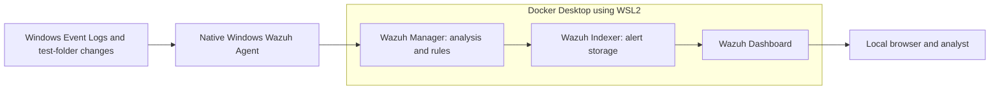

# Mini SOC Home Lab

> **Repository scope:** This is a documented, verified personal lab build, not a one-command fresh installer. Verification refers to September 2026; current service health is not implied.
>
> **Fresh clones:** The `private/` directory, passwords, password hashes, certificates, private keys, Docker volumes, and agent MSI are intentionally excluded. Generate your own credentials and certificates before starting Compose. See [repository setup notes](docs/REPOSITORY_SETUP.md).

## Project documents

- [README as PDF](SOC_Lab_README.pdf)
- [Architecture and walkthrough PowerPoint](Mini_SOC_Home_Lab_Documentation.pptx)
- [Quick start for the configured laptop](QUICK_START.md)
- [Alert investigation](docs/INVESTIGATION.md)
- [Verified alert evidence](evidence/verified-demo-alerts.json)

Status: the basic lab is operational. The Windows endpoint is active, six harmless demonstration alerts were verified in the indexer, and the user successfully signed into the dashboard in Edge. The dashboard screenshot shows one active agent. The user located the modification alert in the dashboard; its screenshot is saved. Expanded event fields remain available for the next learning step.

## Objective

Build a first cybersecurity project that monitors this Windows laptop, detects harmless file changes, and explains one alert from event collection to investigation.

## Architecture

Deployed architecture:

All project storage will remain on Windows. Ubuntu partitions, EFI, the bootloader, and the external SSD are outside this project's scope.

## Technologies

Verified: Windows 11 Home Single Language 25H2, Docker Desktop 4.89.0, Docker CLI 29.7.2, Docker Compose 5.5.0, WSL 2.7.12.0, Git, and Wazuh 4.14.7 central components.

## Wazuh Components

Deployed: one manager to analyze events, one indexer to store alerts, and one dashboard to investigate them. No additional security products are needed for the first demonstration.

## Windows Endpoint

Endpoint: `soc-windows`, agent ID `001`, Wazuh agent 4.14.7, Microsoft Windows 11 Home Single Language, x64 host. The manager reports **Active**. The agent runs natively as the Windows `WazuhSvc` service; it is not a container.

Monitored inputs: Application and System event channels; selected Security event IDs; Windows Defender Operational events; and real-time file monitoring of `C:\SOC-Lab-Test`. Application and FIM alert delivery have been demonstrated. A System event was also observed. Security authentication alerts and Defender detections have not been deliberately tested.

## Event Flow

Windows event → agent → manager → rule analysis → alert → indexer → dashboard → analyst.

File integrity monitoring follows the same path, but its event is generated by the agent's file monitoring module rather than Windows Event Logs.

## Installation

System inspection completed on 2026-09-23. C: initially had 181.85 GiB free; usable RAM was 15.61 GiB. Existing WSL2 and Docker Desktop were reused. Official Wazuh 4.14.7 images were downloaded after approval, and the signed Windows agent MSI was installed by the user from Administrator PowerShell. No Windows features or partitions were changed. C: had approximately 174 GiB free after deployment.

Commands used include `wsl --status`, `wsl --version`, `wsl --list --verbose`, `docker version`, `docker compose version`, `docker context ls`, and `docker desktop start --timeout 60`. Subsequent startup attempts used `docker desktop start --detach`.

The user ran `Set-ExecutionPolicy -Scope Process -ExecutionPolicy RemoteSigned` in the administrator session before the prepared installation script. This was a session-only setting. The installation script rechecked the official MSI's signature and SHA-256, installed the service, backed up its original configuration, configured the test folder and event channels, and started the service. Detailed commands and recovery steps are in `docs/setup-log.md`.

## Configuration

Configured: localhost-only service bindings, seven-day retention for alert/monitoring/statistics indexes, and Docker log rotation at 10 MiB with three files per container. Internal manager logs retain seven days; compressed alert archives older than seven days are removed by `scripts/Maintain-Lab.ps1`, also invoked by the start script. Run maintenance weekly if the stack stays up continuously. This is not a hard storage cap and does not shrink Docker's virtual disk automatically.

Container memory limits: manager 2 GiB, indexer 3 GiB (1 GiB JVM heap), dashboard 1 GiB. Each container is limited to two CPU cores. The existing WSL memory allocation was left unchanged. Windows memory was low during startup; close heavy applications before demonstrations.

The manager's vulnerability feed, manager-side FIM/rootcheck, and manager SCA are disabled to keep the first lab focused. The Windows agent configuration enables FIM for the test directory and selected Windows logs; it disables automated responses and SCA. This changes Wazuh features only, not Defender or Firewall.

Dashboard address: https://localhost:8443. Username: `admin`. The login note is `private/dashboard-login.txt`; all generated service passwords are stored in `private/credentials.json`. This protected, Git-ignored directory also contains deployment environment values and certificates. Never publish the private directory or include it in screenshots. Demo indexer users were removed from the initial internal user configuration.

The certificates were generated locally using the official Wazuh tool. Browsers do not trust that private certificate authority by default. The user reviewed the local certificate warning and successfully signed in through Edge. The in-app browser could not open this certificate-protected page.

From the project folder, use `scripts/Start-Lab.ps1` and `scripts/Stop-Lab.ps1`. Stopping preserves data. Avoid `docker compose down -v`, Docker factory reset, or pruning volumes unless intentionally removing the lab and its evidence.

## Security Tests

Completed on this Windows installation:

1. Created `C:\SOC-Lab-Test\test.txt` with harmless text.
2. Appended a second line, changing its size and checksum.
3. Renamed it to `test-renamed.txt`.
4. Deleted only that disposable file after checking its content.
5. Wrote informational Application event 777 from the dedicated `MiniSOCLab` source.

No malware, external scanning, credential attacks, account-lockout tests, or Defender test detections were used. The lab is monitoring-only; automated response is disabled.

## Alerts Observed

All times below are 2026-09-23, UTC+05:30. Evidence is in `evidence/verified-demo-alerts.json`.

| Time | Action detected | Rule | Level |
|---|---|---|---|
| 08:25:02 | `test.txt` added | 554 | 5 |
| 08:26:51 | `test.txt` checksum changed | 550 | 7 |
| 08:27:26 | Old filename removed during rename | 553 | 7 |
| 08:27:26 | New filename added during rename | 554 | 5 |
| 08:31:11 | `test-renamed.txt` deleted | 553 | 7 |
| 08:31:11 | Harmless Application event 777 | 100100 | 3 |

These are successful detections of authorized benign activity, not confirmed attacks. The marker rule is a custom educational rule. The three FIM rule IDs are built-in Wazuh rules.

## Investigation

For the modification alert, rule 550 reported changes to size, modification time, MD5, SHA-1, and SHA-256. The file was in the dedicated test directory and changed at the time of our authorized test. Classification: benign authorized activity; no containment required.

The rename produced two alerts with the same final SHA-256: removal of the old path and addition of the new path. Those matching details and the test timeline support the rename interpretation.

See `docs/INVESTIGATION.md` for each alert's source, analysis, and dashboard filters. Alert evidence was retrieved through the authenticated indexer API. Browser login and the overview are verified in `evidence/01-dashboard-overview.png`; the FIM Events view is verified in `evidence/02-fim-modification-alert.png`.

## Troubleshooting

Docker startup initially failed on stale runtime socket files. Preserving both affected temporary directories before a single fresh launch resolved this startup failure. `docker run --rm hello-world` then passed. See `docs/setup-log.md` for the complete recovery record and backup directory names. Docker data disks were not reset or removed. Recurrence after a future Docker restart remains untested.

The initial custom marker rule used too broad a parent rule and produced no marker alert. Inspecting the installed Windows rules identified Application informational parent rule 60600. After correcting the parent, validating the configuration, restarting only the manager, and writing a fresh event, rule 100100 triggered successfully.

The in-app browser rejected the untrusted local certificate. The user opened Edge, reviewed the warning for localhost, and signed in successfully. No global browser security setting was changed.

## What I Learned

The agent collects evidence, the manager analyzes it, the indexer stores alerts, and the dashboard displays them. A Windows Event ID identifies an event type; a Wazuh rule ID identifies the detection logic. An alert's level helps prioritize review but does not prove malicious intent. FIM monitors file changes directly, so not every Wazuh alert originates in Windows Event Logs.

Troubleshooting taught me to verify each stage separately and use logs before reinstalling software. See `INTERVIEW_NOTES.md` for short explanations and a verified alert walkthrough.

## Future Improvements

Finish the alert-detail walkthrough and screenshots; measure daily disk growth; test startup after a reboot; investigate selected authentication events without risking account lockout; and improve certificate trust through a deliberate lab-only setup. This is a one-endpoint learning lab, not production SOC or incident-response experience.

## Presentation and quick launch

The complete beginner presentation is Mini_SOC_Home_Lab_Documentation.pptx. Detailed source documentation is also included in its speaker notes. Start Docker Desktop, then double-click Launch-SOC-Lab.cmd. See QUICK_START.md for login, shutdown and maintenance instructions. Dashboard dark mode is enabled; refresh Edge to apply it.

